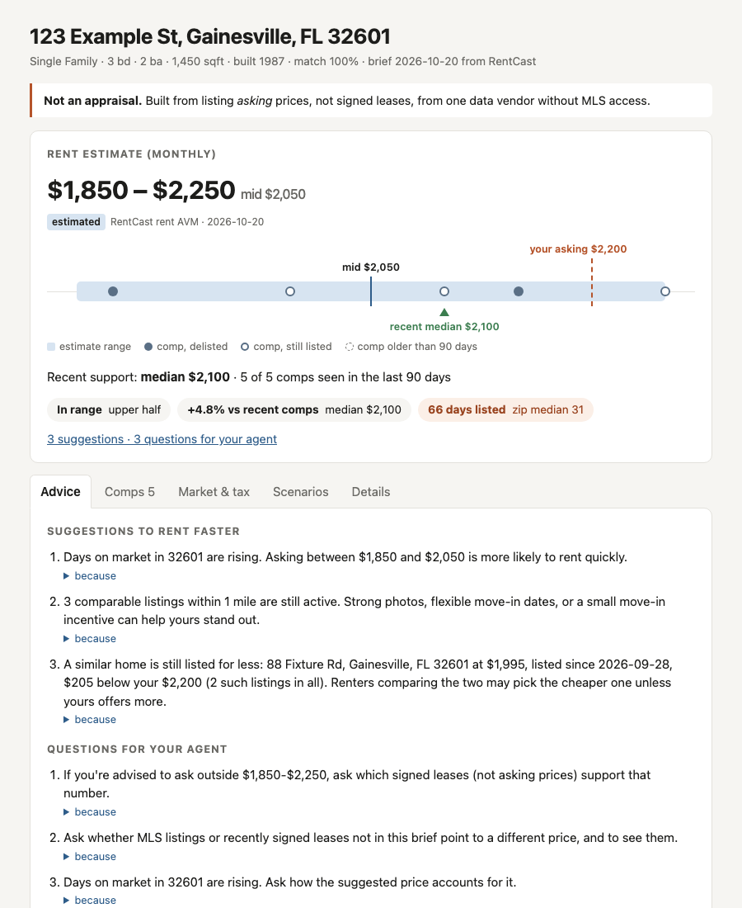

# rentsmart

An independent, evidence-backed rental pricing brief for a US house. Give it an
address and it tells you a rent range, the comps behind it, how fast the zip is
renting, whether your current asking price fits the evidence, and what to ask your
agent. Every number shows its range, source, date, and how much to trust it.

It is a second opinion to check your agent's advice against, not a replacement for
your agent.

> **Not an appraisal. Not financial, legal, or tax advice.** Rent estimates are
> built from asking prices in listings, not signed leases, from a single data
> vendor without MLS access. Read [DISCLAIMER.md](DISCLAIMER.md) before relying on
> a brief.

## Install

Requires [uv](https://docs.astral.sh/uv/) and a [RentCast API](https://www.rentcast.io/api)
key (the free developer plan works).

```bash
git clone https://github.com/Tingmi88/rentsmart.git && cd rentsmart
uv sync
cp .env.example .env        # then add your RentCast API key
direnv allow                # optional: auto-loads .env (or run `source .env`)
```

The API key is read only from the `RENTCAST_API_KEY` environment variable, never
from a flag, and is never written to disk by rentsmart.

## Quick start

```bash
uv run rentsmart "123 Main St, Gainesville, FL 32601"
```

Check your current listing against the evidence:

```bash
uv run rentsmart "123 Main St, Gainesville, FL 32601" --asking 2200 --listed 2026-08-15
```

| Option | Effect |
|---|---|
| `--beds`, `--baths`, `--sqft` | Override vendor facts; also sent to the rent estimate |
| `--roof-year`, `--hvac-year` | Owner facts the vendor lacks; can trigger listing advice |
| `--asking` | Your current asking rent: adds a **YOUR LISTING** check |
| `--listed` | Date the listing went live (`YYYY-MM-DD`); needs `--asking` |
| `--json` | The full brief as JSON, in the contract envelope |
| `--refresh` | Ignore cached responses and fetch fresh data |
| `--run-anyway` | Look the address up as typed even if a similar one was looked up before |
| `--html PATH` | Also write the brief as one self-contained HTML file |

The readable output is rendered from the same data as `--json`, so the two never
disagree.

Before paying for a lookup, rentsmart compares the address with ones already looked up
on this machine. The same address written differently (`Drive` for `Dr`, other
capitalization) reuses the saved lookup for free. A near match (a missing city, a
mistyped zip, a misspelled street, same house number) stops with exit code 17 and a
"did you mean" list, spending no calls. A different house number or unit never counts
as a match.

## Local UI and shareable page



Write a brief as one self-contained HTML file (no external scripts or fonts; opens
offline, prints to PDF):

```bash
uv run rentsmart "123 Main St, Gainesville, FL 32601" --asking 2200 --html brief.html
```

Or open the local app, for trying asking prices and running new addresses:

```bash
uv run rentsmart-ui            # http://127.0.0.1:8765, this machine only
```

- Enter the street (with any unit, e.g. `12814 Tomanet Trl # A`), city, 2-letter state,
  and 5-digit ZIP in separate fields.
- Opening a brief and moving the asking-price slider use cached data only: no API calls.
- If the address isn't cached but a similar one is, the page asks **Did you mean** with
  links to the saved addresses (free) above **Run as entered**.
- Saved data opens however old it is. Past the 7-day reuse window, the brief shows the
  date it was fetched and a **Refresh** button with the cost of refetching only the
  expired parts. The CLI still refetches after 7 days.
- A brief that isn't cached shows a **Run** button with the cost (up to 3 calls) and
  a count of calls made this month on this machine. That count is a guide: calls from
  other machines or the RentCast dashboard aren't included.
- The app listens on 127.0.0.1 only and refuses requests from other sites.
- Before sending a brief to anyone outside your household, check that RentCast's terms
  allow sharing its data.

## Reading the brief

An abridged brief for a synthetic address:

```text
RENT ESTIMATE (monthly)
  $1,850 - $2,250, mid $2,050  [estimated · RentCast rent AVM · as of 2026-10-20]
  Limitations:
    - Based on asking prices from rental listings, not signed lease prices.
    - Does not include MLS listings; your agent may see newer listings.
  Recent support: median $2,100  [computed · computed · as of 2026-10-18]
    5 of 5 comps seen in the last 90 days; Asking prices: $1,875, $1,995, $2,100, ...

YOUR LISTING
  Asking $2,200/mo  [user_supplied · owner (CLI flag) · as of 2026-10-20]
  Range position: upper half (Asking $2,200 is 88% of the way from $1,850 to $2,250)
  vs recent comps: 4.8% above (Recent comp median $2,100; 1 of 5 recent comps ask more; 4 ask less)
  Days listed: 66 (35 days longer than the zip median)

SUGGESTIONS TO RENT FASTER
  * A similar home is still listed for less: 88 Fixture Rd at $1,995, listed since
    2026-09-28, $205 below your $2,200 (2 such listings in all). ...
    because: Active comp: 88 Fixture Rd, $1,995, 3bd/2ba, 1520 sqft; ...
```

### Sections

| Section | What it tells you |
|---|---|
| **Property** | The address RentCast matched, a match confidence, and the facts used |
| **Rent estimate** | RentCast's range and mid, plus "recent support": the median asking price of comps seen in the last 90 days |
| **Your listing** | With `--asking`: where your price sits in the range, versus recent comps, and days listed versus the zip median |
| **Rental comps** | Newest first; older-than-90-day comps below a divider |
| **Market speed** | Zip-level median days on market and its trend |
| **Property tax** | Latest annual bill: an owner cost, not a rent input |
| **Pricing scenarios** | Low / mid / high asking rents with the *direction* of speed only |
| **Suggestions, questions** | Rule-based advice; each line shows `because:` with the evidence it cites |

### How much to trust each value

Every value is tagged `[kind · source · as of date]`:

| Kind | Produced by | Trust |
|---|---|---|
| `fetched` | Vendor records (property, tax, listings, market) | High, but may lag |
| `estimated` | Vendor model (rent AVM) | Medium: use the range, not the point |
| `computed` | rentsmart's arithmetic on the values above | Exact given its inputs |
| `user_supplied` | Your flags | As good as what you entered |
| `advised` | Rules citing evidence in the brief | Shows its reasoning; check it |

### Markers

| Marker | Meaning |
|---|---|
| `STALE` | Older than the freshness threshold (90 days; tax 550 days) |
| `asking` / `leased` | Whether a comp's price was asked or signed. RentCast comps are `asking` |
| `active?  UNCONFIRMED` | Listed as active but not seen by RentCast for over 14 days |
| `None: the evidence ... doesn't support any` | No rule had evidence to cite. That is not an all-clear |

### Exit codes

| Code | Meaning |
|---|---|
| 0 | Brief produced |
| 10 | Address not found |
| 11 | Ambiguous address: candidates listed, rerun with one |
| 12 | Too few comps: no reliable range; what exists is shown |
| 13 | Stale data: brief produced with a staleness flag |
| 14 | Provider quota used up: no output |
| 15 | Configuration error (e.g. missing API key, bad setting) |
| 16 | Provider error (network, refused request, unexpected response) |
| 17 | Similar address already looked up: no calls made; rerun with it or `--run-anyway` |

## Data sources

All data comes from the RentCast API: property records, tax, the rent estimate,
rental comps, and zip-level market statistics. No MLS, no scraping, and no owner or
personal data. Optionally, a zip rent trend from Zillow's Observed Rent Index
(below). See [docs/data-sources.md](docs/data-sources.md) for which
endpoint feeds each section, what the vendor fields mean, and freshness rules.

## API usage and the cache

A first brief for an address costs about 3 RentCast requests. Responses are cached
on your machine for 7 days (`~/.cache/rentsmart/`), so re-running a brief, with or
without `--asking`, is free. Changing `--beds`, `--baths`, or `--sqft` re-requests
only the rent estimate (1 request).

| Setting | Default | Effect |
|---|---|---|
| `--refresh` | off | Skip the cache for this run |
| `RENTSMART_CACHE_DAYS` | 7 | How long cached responses are reused; `0` disables |
| `RENTSMART_CACHE_DIR` | `~/.cache/rentsmart` | Where the cache lives |
| `RENTSMART_STALE_AFTER_DAYS` | 90 | When data is flagged stale |
| `RENTSMART_ZORI_CSV` | unset | Path to a ZORI file; adds the zip rent trend (below) |

The cache holds addresses and property data, never your API key. Errors and quota
failures are never cached. Delete the folder to clear it.

### Zip rent trend (optional)

To add how rents in the zip changed over the last 12 months, download the ZIP-level
"ZORI (Smoothed): All Homes Plus Multifamily Time Series" CSV from
[Zillow Research](https://www.zillow.com/research/data/)
(`Zip_zori_uc_sfrcondomfr_sm_month.csv`) and point
`RENTSMART_ZORI_CSV` at it. rentsmart reads the file locally and never contacts
Zillow. ZORI tracks asking rents for all home types, including apartments, so only
its change is shown, never its dollar level. Re-download it monthly; it's flagged
stale after 90 days. Data credit: Zillow.

## What it does not do

- Not an appraisal; not financial, legal, or tax advice.
- No neighborhood quality judgments, demographics, or crime data (fair housing).
  Property facts and transactions only.
- No owner contact or personal data, even if a provider offers it.
- No scraping of sites whose terms forbid it.
- No predicted day counts for your home: market speed is zip-level only, and
  scenarios give direction ("likely faster than the zip median").
- No hosted or mobile app: the UI runs only on your machine.

## Development

```bash
uv sync
uv run pre-commit install
uv run pytest
uv run ruff check . && uv run ruff format --check . && uv run pyright
```

Browser tests for the local UI (`tests/ui/`) use Playwright and are skipped by a
plain `pytest`. Install Chromium once, then run them:

```bash
uv run playwright install chromium
uv run pytest -m ui
```

Tests replay recorded RentCast responses in `tests/fixtures/`; they never call the
live API. To record real fixtures (about 3 requests per address, bypasses the cache):

```bash
uv run python scripts/record_fixtures.py "123 Main St, City, ST 12345" my-slug
```

### Golden-set evaluation

`benchmarks/golden.toml` lists addresses whose actual signed lease is known (or
pending). Each entry's RentCast responses are recorded **while the home is listed**
(no hindsight), then replayed offline:

```bash
uv run rentsmart-eval                    # report: coverage, range width, error
uv run rentsmart-eval --check            # fail if worse than benchmarks/baseline.json
uv run rentsmart-eval --update-baseline  # accept current metrics (review first)
```

Coverage is always reported with range width: a range that is always right because
it is huge is a failure. CI runs `--check` on every push.

To add an entry: record fixtures, add a `pending` entry; when it leases, set
`status = "leased"`, `lease_price`, `lease_date`, then update the baseline.

### Releases

Versions and `CHANGELOG.md` are generated from conventional commits by
python-semantic-release. To cut a release: GitHub → Actions → **Release** → Run
workflow. It reruns all checks, bumps the version (`feat` → minor, `fix`/`perf` →
patch while on 0.x), updates `CHANGELOG.md` and `uv.lock`, tags `vX.Y.Z`, and
publishes a GitHub release with the built wheel. Preview the next version:

```bash
uvx --from python-semantic-release==10.7.0 semantic-release --noop version --print
```

See [AGENTS.md](AGENTS.md) for project rules and
[docs/problem_statement.md](docs/problem_statement.md) for the spec.

## License

MIT. See [LICENSE](LICENSE). Data returned by RentCast stays subject to
[RentCast's API terms](https://www.rentcast.io/terms-api).
